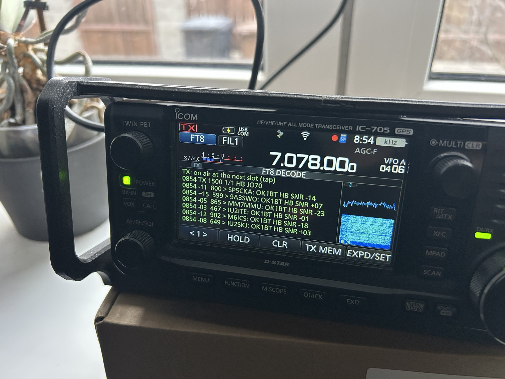
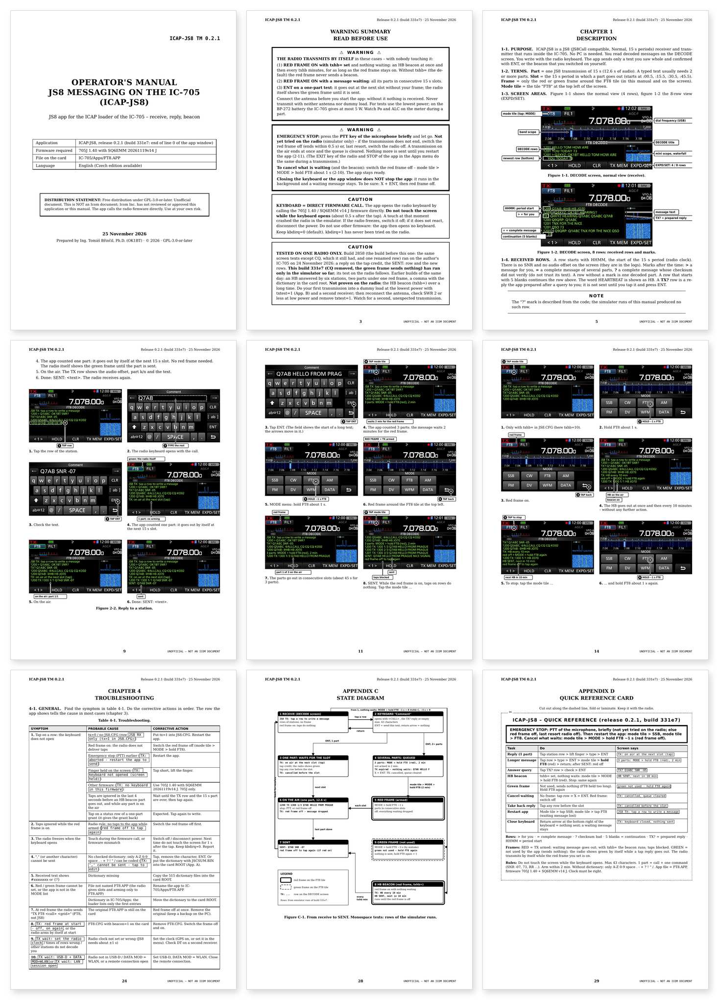
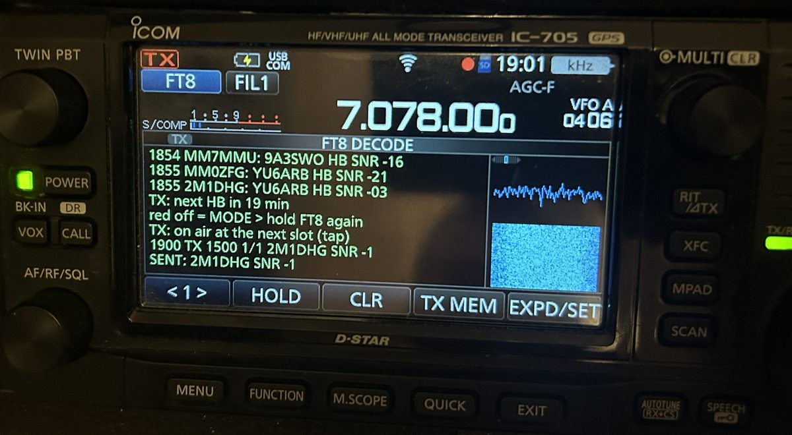
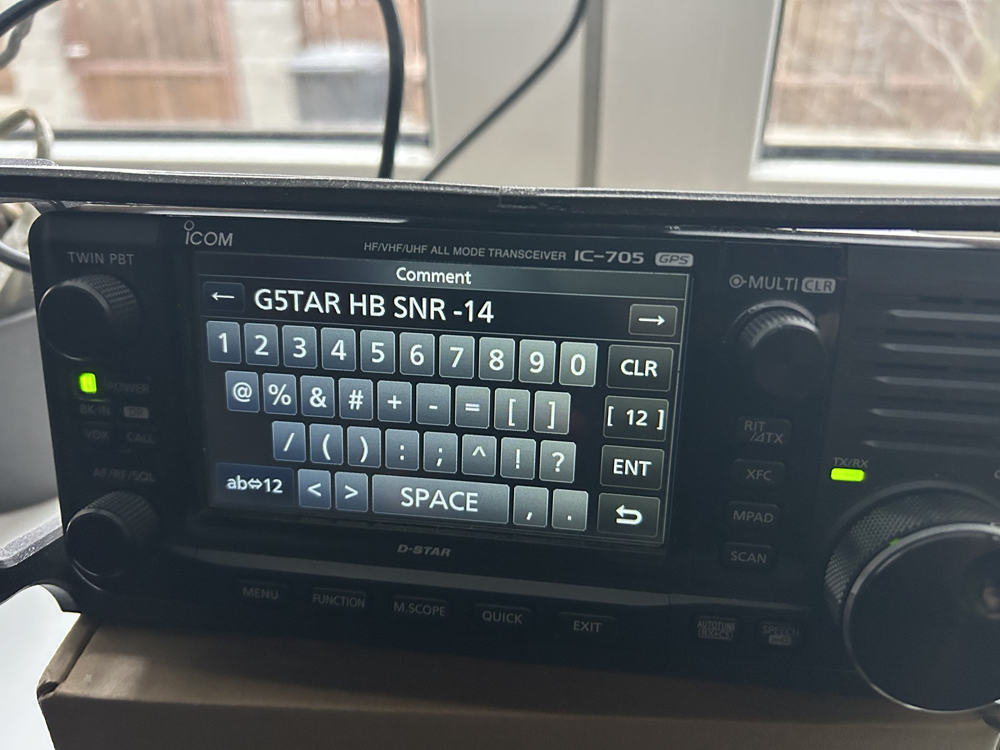
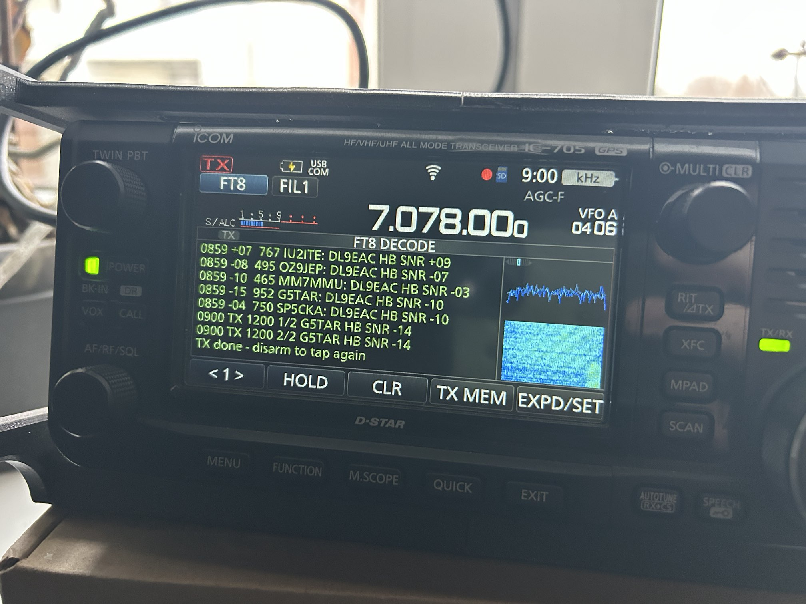
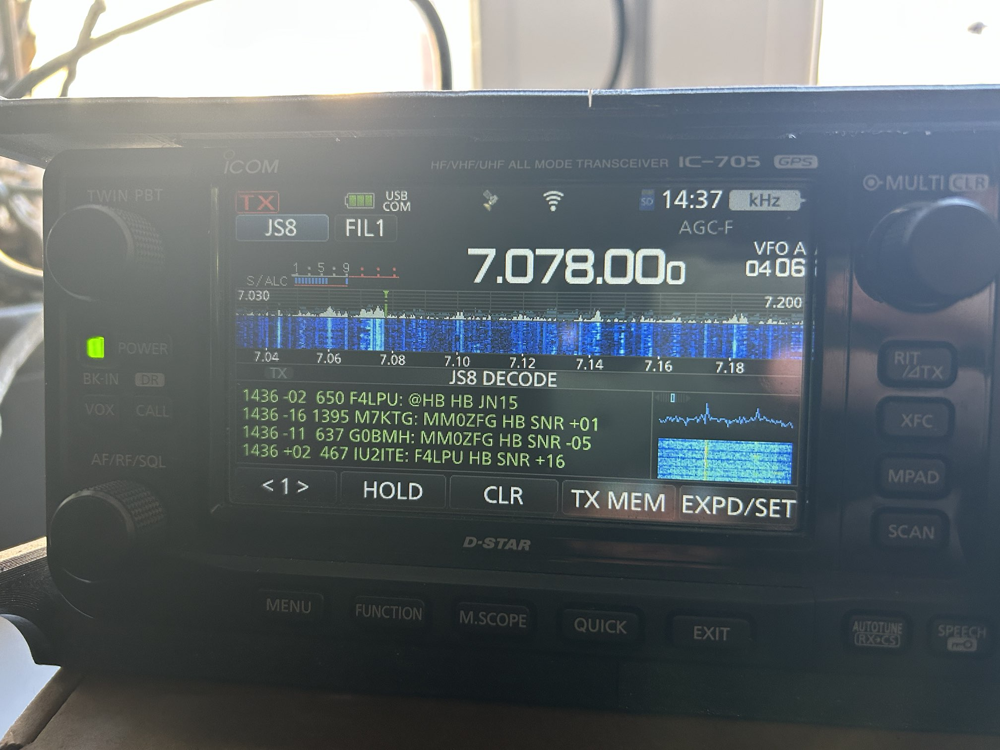
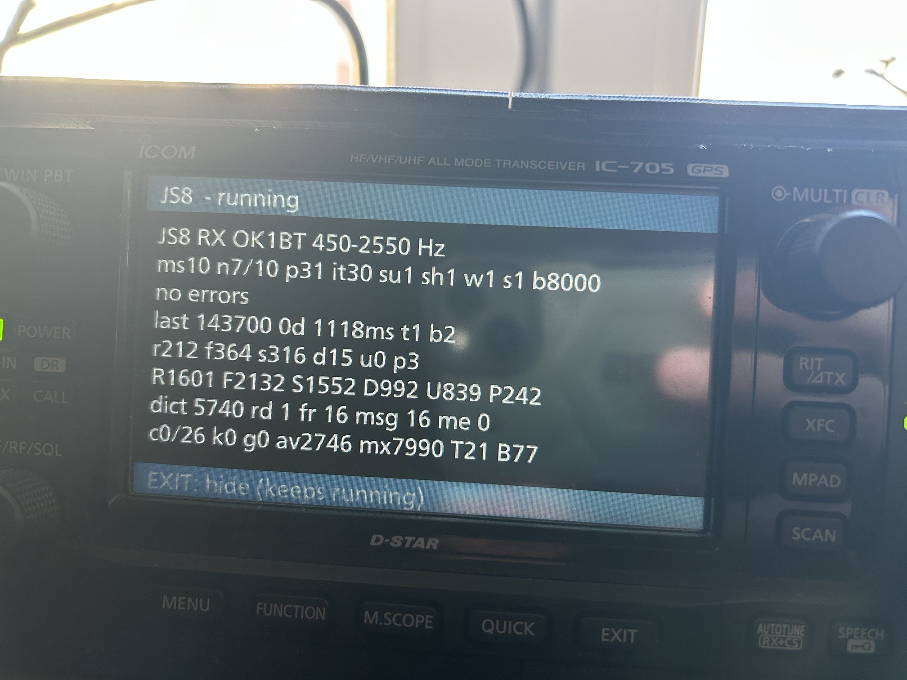

# icap-js8 - JS8 for the Icom IC-705 (ICAP app): receive, write on the radio's keyboard, transmit



*The author's IC-705, 24 November 2026, 7.078 MHz, 5 W: a heartbeat typed on the radio's own keyboard and sent on the loader's tap credit, and six stations answering it (heartbeat SNR replies). More under [Photos](#photos).*

A JS8Call-compatible app (submode Normal, 15 s periods) that runs inside the IC-705 under the ICAP loader of the custom firmware by Dawid SQ6EMM. It decodes JS8 from the radio's own audio and shows it on the DECODE screen, and since 0.2.0 it **transmits**: you tap a decoded row, write the message on **the radio's own keyboard**, press ENT, and the radio sends it. No computer is attached.

The code, the tests and the documentation were written by an AI coding assistant (Claude, by Anthropic) under the direction of Tomas Brincil OK1BT, who tested it on his radio. No human has reviewed the code line by line. See [How this was made](#how-this-was-made) and [`AUTHORS.md`](AUTHORS.md).

**Read this first:** the project is new (November 2026). The build of release 0.2.1 has so far run only in the simulator; the build before it (the same screen texts except CQ and one renamed row) ran on the radio. Transmitting has run on one radio (IC-705, J version) on two days, on one band. The keyboard works only on **705J firmware 1.40 with SQ6EMM's custom firmware 20261119v14 J** - read [Safety](#safety) before you install it.

## Manual

<a href="docs/manual/ICAP-JS8-TM-EN.pdf"><picture><source media="(prefers-color-scheme: dark)" srcset="docs/img/manual-preview-dark.jpg"></picture></a>

**Operator's manual ICAP-JS8 TM 0.2.1** (A4, print-ready, the screens drawn with BI1BIF's emulator of the radio): [English PDF](docs/manual/ICAP-JS8-TM-EN.pdf) · [Czech PDF](docs/manual/ICAP-JS8-TM-CZ.pdf). Step-by-step tasks with pictures, every row the app writes and what to do about it, troubleshooting and a quick reference card to cut out. The short version is below.

## How to operate

The transmit app is `FT8.APP` (it must have that file name, see [Install](#install-in-5-minutes)); on the radio its mode tile reads **FT8**. Transmitting is off until `JS8.CFG` says `tx=1`.

| What you want | What you do on the radio | What goes on the air |
|---|---|---|
| Reply to a station | Tap its decoded row and lift the finger. After about a second the radio's keyboard opens with `<CALL> ` (the station's call). Write the rest, press **ENT**. | A text that fits **one part** goes out at the next 15 s slot on the loader's **tap credit**, with no arming (`TX: on air at the next slot (tap)`). A longer text waits (`2 parts: MODE > hold FT8 (red), 2 min`): arm the **red frame** within 2 minutes (tap the mode tile at the top left -> MODE screen -> hold the **FT8** tile about 1 s) and its parts go out in consecutive slots. When it is sent: `SENT: <text>`, and with the red frame on also `red frame off to tap again`. While a one-part reply is on the air, the radio itself lights the **green** frame on the mode tile and switches it off afterwards. |
| Answer a query to you (`SNR?`, `GRID?` ...) | Tap the query, or the `TX? <reply>` row the app prints below it. The keyboard opens with the prepared reply. **ENT**. | That reply, one part, as above. |
| Write to nobody in particular | Tap any other row: the keyboard opens empty. Write, **ENT**. | As above. |
| Heartbeat beacon (HB) | Put `txhb=<minutes>` (10..240) into `JS8.CFG`. Arm the red frame while nothing is queued. | `HB <grid>` at once and then every `txhb` minutes while the red frame is on (`HB SENT, next in 30 min`). Red frame off stops it (`red off = MODE > hold FT8 again`). It transmits with nobody touching the radio: unattended operation may need a separate permit and its own part of the band - check your licence. |
| Green frame by mistake | FT8 held about 3 s instead of 1 s: the green frame comes on. Hold **FT8** again until it is gone. | **Nothing.** The app does not call CQ and does not use the green frame (`green not used - hold FT8 again`). |
| Change the waiting message | Tap a row, write the new text, **ENT**. | Only the new text; the old one is dropped, even if it had started. |
| Cancel a waiting message | Red frame armed: switch it **off**. Not armed: tap a row, write `X` (or leave the keyboard empty, or `CANCEL`), **ENT**. | Nothing (`TX: cancelled, queue cleared` / `TX: red frame off - message dropped`). |
| Stop a granted one-part text before its slot | Tap any row. | Nothing (`TX: cancelled before the slot`). |
| Close the keyboard without sending | The **return arrow** at the bottom right of the keyboard. | Nothing (`TX: keyboard closed, nothing sent`). |
| **Emergency stop** of a part that is on the air | Press the **PTT key of the microphone** briefly and let go (not yet tried on the radio, only in the simulator; if it does not stop, switch the red frame off or, last resort, the radio). (The radio's EXIT key or STOP of the app in the Apps menu do the same.) | The part ends within 0.5 s and the queue is cleared; nothing more is sent until the app is restarted (`TX: aborted - restart the app to send`; restart: MODE > SSB, then MODE > FT8). Switching the red frame off also ends a part, without the restart. |

Good to know:

- **Arming.** The red frame is armed on the MODE screen, not on the main screen: tap the mode tile at the top left to open the MODE screen; there, hold the **FT8** tile about **1 s** and let go as soon as the frame turns red. Held about 3 s it turns green, which the app does not use (hold again to switch it off). The MODE screen stays open; close it with the return arrow at the bottom right. In the radio's words a JS8 frame is a **part** on the screen, because "frame" there is the red or green frame of the mode tile.
- **Which texts are one part.** `HB <grid>` and a call followed by one JS8 command: `<CALL> SNR -08`, `<CALL> 73`, `<CALL> RR`, `<CALL> HB SNR -14`, `<CALL> SNR?`, `<CALL> GRID?`, `<CALL> QSL?` and the like. Anything with free words (`<CALL> HI`, `<CALL> TNX`, `<CALL> GRID JO70`) is two parts or more and needs the red frame.
- **While the red frame is armed, taps do not reach the app** (that is the loader's rule): to write the next message, switch the red frame off first.
- **What goes out is exactly what you saw on the keyboard** when you pressed ENT - at most 43 characters. A longer text, or a character JS8 cannot send, is refused with a row that says why; nothing is cut.
- **One message waits at a time.** A new ENT replaces it.
- **The radio's EXIT key does not stop the app** while nothing is on the air; it keeps running in the background. To be sure nothing goes out: an empty ENT (the cancel) and the red frame off.
- Every change of what goes on the air is a row on the DECODE screen. Rows are at most 40 characters.

## Install in 5 minutes

You build the files yourself; this repository ships no program binaries and no dictionary ([`docs/BUILDING.md`](docs/BUILDING.md)). You need `make`, a C compiler, `python3`, `git`, `curl` and an `arm-none-eabi-gcc` bare-metal toolchain (we used Arm GNU Toolchain 12.2.rel1).

```
make fetch     # ICAP SDK, seven JS8Call source files and two licence texts into third_party/ (network, once)
make dist      # build/dist/ (laid out like the card) and build/icap-js8-sdcard.zip
               # if the ARM compiler is not in PATH: make dist CROSS=/path/to/bin/arm-none-eabi-
```

Then, with a card reader:

1. **Back up and remove the original `FT8.APP` from `\IC-705\Apps\`, and any `FT8.CFG`.** The loader gives 15 s slots and beacon arming only to an app whose file is named `FT8.APP`, so this app must take that name and replace the firmware's FT8 app while it is installed (put the original back to use FT8 again). If both were on the card, arming would start the original FT8 app too - on the test radio that once sent an FT8 frame. A leftover `FT8.CFG` with `beacon=1` would arm the beacon at start; the app ignores such an arming, but the file should go.
2. **Copy the dictionary to the card ROOT**: the 515 files `JSCHEAD.BIN`, `JSCD000.BIN`..`JSCD0FF.BIN`, `JSCES.BIN`, `JSCE000.BIN`..`JSCE0FF.BIN` and `JSCSUM.BIN` from `build/dist/` (4.65 MB) go into the top folder of the card, **not** into `\IC-705\Apps\`. They are generated by `tools/mkjsc.py` from JS8Call's word list. Receiving needs `JSCHEAD`/`JSCD*`; sending free text needs `JSCES`/`JSCE*` and `JSCSUM.BIN`, without which only heartbeat and the one-word commands can be sent. (With the dictionary in the Apps folder, some apps did not appear in the radio's Apps list on the test radio. An older copy in `\IC-705\Apps\` can be deleted.)
3. Copy `build/dist/IC-705/Apps/FT8.APP` and `JS8.CFG` to `\IC-705\Apps\`. Edit `JS8.CFG`: `tx=1` to transmit, `loc=` if the radio has no position set (see [JS8.CFG](#js8cfg-keys-for-transmitting)).
4. On the radio: your call sign set (the app uses the radio's own, or `call=` in `JS8.CFG`), clock accurate to about a second (GPS), no remote (LAN) connection. Tune to 7.078 MHz (or another JS8 frequency) and select the mode **FT8** (RTTY button, repeatedly; the loader switches to USB-D). JS8 rows appear after the first full period. Line 0 of the app window reads `JS8 RX+TX <call> 450-2550 Hz 331e7` (`331e7` is the build id of this release).
5. First transmission: into a dummy load at minimum power (`txtest=1` sends only `HB <grid>`, one part per app run; afterwards reconnect the antenna, check SWR at low power and remove `txtest=1`). Watch the rows on the DECODE screen. Only then transmit into the antenna.

`build/dist/receive-only/JS8.APP` is the receive-only build (no transmit code in it, mode tile `JS8`); it can stay on the card next to `FT8.APP` or be used instead of it.

**Uninstall:** select another mode; delete `FT8.APP` (and `JS8.APP`), `JS8.CFG`, and the files the app wrote into `\IC-705\Apps\` (`JS8*.TXT`, `JS8*.PCM`, `JS8*.BIN`, `JS8*.ADI`); delete the `JSC*.BIN` files from the card root; put the original `FT8.APP` back.

## Safety

**The rule.** A part is keyed only for a text you saw whole on the radio's keyboard and confirmed with ENT - or the HB of a red-frame arming with `txhb=` set - and only with the radio's own permission: the loader's tap credit (one tap = at most one transmission of one part; the loader decides) or your red frame. No automatic replies, no repeats. With nothing queued the app never asks to transmit. Transmitting is off unless `JS8.CFG` says `tx=1`; a value the app does not understand switches it off. An arming that was already there when the app started does not count until it was seen off once. The rules are written out at the top of `src/js8tx.h`.

**The keyboard is a direct call into the radio's firmware.** The ICAP loader offers apps no text entry. To open the radio's own on-screen keyboard (the stock D-PRS comment editor), `shell/js8app_kbd.h` calls three functions of the IC-705 firmware at fixed addresses. The entry points were found by **BI1BIF** ([IC-705-Firmware](https://github.com/BI1BIF/IC-705-Firmware)). This is outside what the SDK documents:

- It is meant for **705J firmware 1.40 with SQ6EMM's custom firmware 20261119v14 J only.** Before the calls the app compares the first four instruction words of each of the three functions with that image; on any other firmware it says `KBD: not 705J 1.40 / v14 J - no keyboard` and never calls them. Receiving still works; transmitting then has no way to enter text.
- **Known risk:** in BI1BIF's emulator, a touch on the screen while the keyboard is being opened crashed the radio. The app therefore opens the keyboard 800 ms after the tap was reported (a tap is reported when the finger lifts), only from its main loop, and only if the screen is still the one the tap was made on. Keep your finger off the screen until the keyboard is up. This risk was not tested on the radio.
- The app runs in the CPU's **System mode** under the loader, so it can reach the firmware's memory; that is how these calls are possible at all, and also why an error in the app can freeze the radio rather than end only the app. With `kbdirq=1` the three calls would run with interrupts disabled; that was never tried on the radio - keep the default `kbdirq=0`.
- While the keyboard is open the app does not leave: on a stop request it closes the keyboard itself first. A keyboard left open for 120 s without ENT is closed by the app.

**General.** The custom firmware is not from Icom; its author states that modifying radio firmware is at your own risk and your own responsibility for complying with your licence and local regulations. This repository contains no Icom code and no firmware images; it holds only the three addresses and twelve instruction words it compares (`NOTICE.md`, section 2.1a). Install apps only from sources you trust, and that includes this one: it was written with an AI assistant and no human has reviewed it line by line. You are responsible for what your station transmits. No warranty (`LICENSE`).

## JS8.CFG: keys for transmitting

`JS8.CFG` lives in `\IC-705\Apps\`. One `key=value` per line (several on one line separated by blanks also work); key names in any case; a line starting with `#` or `;` is a comment. The app reads up to 800 bytes once at start. The sample `sd/JS8.CFG` has transmitting off.

| Key | Meaning | Default |
|---|---|---|
| `tx=1` | **transmitting on.** Without it, or with any value the app does not understand, `FT8.APP` only receives and its first row says `JS8 RX only (tx=1 in JS8.CFG)`. | 0 |
| `txhb=<minutes>` | heartbeat beacon: 10..240 minutes, sent while the red frame is armed with nothing queued; 0 = off | 0 |
| `txsess=<frames>` | at most this many parts (JS8 frames) per app run (1..500) | 20 |
| `loc=JO70` | your locator, used when the radio has no position (`@MYLOC`). Without a call sign and a locator every message is refused. | the radio's |
| `call=` | your call sign, overrides the radio's | the radio's |
| `kbdirq=0` | keep 0: the keyboard calls run with interrupts enabled, the way that was tested on the radio | 0 |
| `popup=0` | no modal pop-up for messages to you. Keep 0 in `FT8.APP`: the tap that dismisses a pop-up might reach the app as a row tap. | 0 (in `FT8.APP`) |
| `txtest=1` | test mode: only `HB <grid>`, exactly one part per app run - for a first try into a dummy load | 0 |

A queued message expires after 2 minutes without an arming. The other `tx*` keys (`txttl`, `txtap`, `txmaxf`, `txf`, `txstrat`, `txjsc`) are described at the top of `shell/js8app.c`; their defaults are the tested ones. An unknown `tx*` key (a typing error) is refused with a note.

Receive keys and the decoder tuning keys are under [Receiving](#receiving).

## Limits

- **Firmware:** the keyboard only on 705J 1.40 / SQ6EMM 20261119v14 J. Other IC-705 versions (E ...) were not tried; the IC-9700 is not supported by this build.
- **File name:** the transmit app must be `FT8.APP` and replaces the firmware's FT8 app while installed; the mode tile reads `FT8`.
- **43 characters** per message (the keyboard's limit). JS8 Normal only. Most typed texts are two parts or more and need the red frame.
- **Without the full dictionary in the card root** only heartbeat and the one-word commands can be sent: free text needs `JSCE*`, `JSCES.BIN` and `JSCSUM.BIN` (on the test radio, a text with a comma went out only after the full dictionary was in the root).
- **Taps are not delivered while the red frame is armed.** One message waits at a time; at most `txsess` frames per run.
- **Untested on the radio:** the whole build `331e7` of this release; the PTT emergency stop (simulator only); the repeated HB of `txhb=` over a long time (the HB itself was sent from the radio); `kbdirq=1`; loader situations that the simulator models but nobody provoked on the air.
- **Audio offset:** the app picks a free audio offset itself (600-2400 Hz, preferring near 1500 Hz); look at the waterfall before you send. JS8Call sends heartbeats between 500 and 1000 Hz; this is band etiquette, not a decoding problem.
- **Abort:** PTT (or EXIT / STOP) during a part cuts the audio at full level, without a ramp.
- **Not used:** PSKReporter spotting (`@SPOT`), DECODE > SET. A comparison with JS8Call on the same audio was not made.
- **SD card writes:** every period is stored on the card before decoding (about 56 MB per hour of listening, over the same two files).

## Status

Date of this status: 25 November 2026. Radio: one IC-705 J, custom firmware 20261119v14 J, 7.078 MHz, 5 W, the builds of 23 and 24 November 2026. **The build of this release, `331e7`, has not run on the radio yet** (released on 25 November with the owner's consent before its radio test); it differs from build `2858`, which ran on the radio on 24 November 18:59-19:01, by the removal of CQ (the green frame sends nothing), `?` winning over `>` and one renamed row (`CHANGELOG.md`).

| Feature | Status | Notes |
|---|---|---|
| Receive JS8 Normal, multi-part messages joined | **Tested on the radio** | Since 0.1.0; multi-part messages from other stations decoded and joined on 24 November. The decoder is the one of 0.1.0. |
| Decode time | **Measured on the radio** | About 2.7 s per period on average (35 periods on 40 m, with the 0.1.0 receive build; `docs/PERFORMANCE.md`). |
| Tap a row -> the radio's keyboard opens, prefilled with the call | **Tested on the radio** | 24 November (photo below). |
| One-part text on the tap credit, no arming | **Tested on the radio** | 24 November: an HB typed on the keyboard went out on the tap credit and six stations answered (SP5CKA, 9A3SWO, MM7MMU, IU2ITE, M6ICS, IU2SKJ, heartbeat SNR replies). |
| Two-part message under one red-frame arming | **Tested on the radio** | 24 November: a two-frame reply went out in consecutive slots (photo below). |
| Free text with the dictionary in the card root | **Tested on the radio** | 24 November: a text with a comma went out after the full dictionary was moved to the card root. |
| The rows of this release (`SENT:`, `N parts: MODE > hold FT8 (red)`, rows without SNR) | **Tested on the radio** (build `2858`) | 24 November 19:00: a one-part reply on the tap credit, `SENT: <text>` after it. |
| Build `331e7` of this release (no CQ) | **Simulator only** | `make test`; the radio test follows. |
| CQ | **Removed** | The owner decided on 24 November 2026 that the app does not call CQ. In the one try before (24 November 18:59) the CQ of the green frame had expired unsent. |
| Heard by others | **Seen** | 23 November: the first HB from the radio (an earlier build) was heard by M7ECR at 923 km with JS8Call. 24 November 11:03 UTC: spotted by F4VTQ/U at 630 km (UberSDR). |
| HB beacon `txhb=` over a long time, cancel and stop rules | **Simulator** | `make test` (`tests/fix_e2e.py`, `tests/tx_e2e.py`, `tests/t7_tx.c`). |
| Sensitivity, false decodes | **Simulator** | `docs/PERFORMANCE.md`. |
| Submodes Fast, Turbo, Slow | Not done | |

What did not work and was removed: the raw touch byte that the emulator suggested for "finger off the screen" does not mean that on the real radio; the app now waits a fixed 800 ms after the tap.

## Receiving

The receive side is as in 0.1.0, with the dictionary looked up in the card root first (then in `\IC-705\Apps\`) and a more forgiving `JS8.CFG` parser.

| Key | Meaning | Default |
|---|---|---|
| `scope=450-2550` | span of the mini-scope for the mode (read by the loader or the firmware, not by this app; on a line of its own) | - |
| `flo=`, `fhi=` | search range for the audio frequency of the lowest tone, Hz; a range narrower than 100 Hz is refused | 450, 2550 |
| `groups=` | group calls marked as "to my group", e.g. `groups=@ALLCALL,@OK` | none |
| `keep=` | log segment files kept per log, 2..9999 | 600 |
| `perf=0` | do not write `JS8PERF.TXT` | 1 |
| `popup=` | pop-up for messages to you: 1 in the receive-only `JS8.APP`, 0 in `FT8.APP` | see left |

Decoder tuning keys (out-of-range values are clamped): `minscore=0..60` (10), `nsync=0..21` (7), `ns34=0..21` (10), `passes=1..31` (31), `iters=5..50` (30), `sub=0..2` (1), `shift=0|1` (1), `wide=0|1` (1), `stream=0|1` (1), `budget=0|1000..14500` ms (8000), `maxcand=10..300` (300). What each does: `docs/PROTOCOL.md` and the top of `shell/js8app.c`. Three presets are in `sd/presets/`: `DEFAULT.CFG` (the same as no tuning keys; measured on the radio), `FAST.CFG` and `DEEP.CFG` (simulator only).

### DECODE rows

```
0854 > Q5ABC: OK1BT HB SNR -14
0900 TX 1200 1/2 Q7AB HB SNR -14
SENT: Q7AB HB SNR -14
```

`0854` start of the period (hhmm, radio clock), then the text; `=` before the text marks a complete multi-part message, `>` a message to you, `?` a message whose checksum did not match: its unverified end is cut off and the rest may be wrong (`?` wins over `>`). SNR and audio frequency are not on the screen any more; they are in the log `JS8Lnnnn.TXT`. `HB` is the screen's short form of `HEARTBEAT`. A row `HHMM TX <f0> k/n <text>` is a part you sent (part k of n). Rows starting with five blanks continue the row above.

### The app window

MENU, the Apps entry of the custom firmware, then tap the app. Eight lines of 40 characters. Line 0: `JS8 RX+TX <call> <flo>-<fhi> Hz <build id>` (`JS8 RX ...` in `JS8.APP`). Line 1 in `FT8.APP`: the transmit status (`TX disarmed s0/20` = not armed, 0 of 20 frames of this run used); in `JS8.APP` the decoder tuning. Line 2: the last note or error. Lines 3 to 7: the last period, stage times, maxima, dictionary and counters, as described at the top of `shell/js8app.c`. EXIT hides the window; the app keeps running.

### Files the app writes into `\IC-705\Apps\`

`JS8CAPA.PCM`, `JS8CAPB.PCM` (the two capture files), `JS8Lnnnn.TXT` (every frame received, every note, every frame sent), `JS8Mnnnn.TXT` (complete messages), `JS8PERF.TXT` (decode times), `JS8STA.BIN` / `JS8STB.BIN` (the app's state), `JS8Annnn.ADI` (only when the loader has no log of its own). Each log is a ring of `keep=` segment files, each written once. The logs contain the call signs heard on the air.

## Photos

All photos: the author's IC-705 (J), custom firmware 20261119v14 J, 7.078 MHz (40 m), taken by Tomas Brincil OK1BT. Metadata was removed ([`docs/img/README.md`](docs/img/README.md)). The call signs that can be read are those of stations heard in public transmissions on the air.

**Heartbeat and six replies** (top of this page), 24 November 2026. From the top: `TX: on air at the next slot (tap)` - the HB typed on the keyboard was granted on the tap credit, no arming; `0854 TX 1500 1/1 HB JO70` - the part on the air, one of one, at 1500 Hz; then six stations answering with a heartbeat SNR report addressed to the author (`>` = to me): SP5CKA, 9A3SWO, MM7MMU, IU2ITE, M6ICS, IU2SKJ.



**Build 2858 on the radio** (the build just before 0.2.1: the same screen texts except CQ, which it still had, and one renamed row), 24 November 2026 19:01: rows without SNR, the beacon's `TX: next HB in 19 min` and `red off = MODE > hold FT8 again`, then a one-part reply typed on the keyboard, granted on the tap credit (`TX: on air at the next slot (tap)`), on the air (`1900 TX 1500 1/1 2M1DHG SNR -1`) and done (`SENT: 2M1DHG SNR -1`). While it was on the air the radio itself showed the green frame on the mode tile.



**The radio's own keyboard**, 24 November 2026, opened by a tap on a decoded row of G5TAR and prefilled with the call; the reply `HB SNR -14` was typed after it. ENT sends exactly this text.



**Two parts in consecutive slots**, 24 November 2026: that reply went out as two parts (`1/2`, `2/2`) under one red-frame arming. The last row is the wording of that build; this release says `SENT: <text>` and `red frame off to tap again`, and it sends `<CALL> HB SNR -14` as the one-frame JS8 command HEARTBEAT SNR.



**Release 0.1.0, receive only**, 23 November 2026: the first decodes, four rows of stations heard on 40 m.



**The app window of 0.1.0**, 23 November 2026: line 0 `JS8 RX OK1BT 450-2550 Hz`; line 1 the decoder tuning (the defaults); line 3 the last period (`0d 1118ms`: nothing decoded, 1.1 s); line 7 `c0/26 ... av2746 mx7990`: 26 periods, none cut, 2.7 s average and 8.0 s longest decode.

## Building and testing

Short version (details in [`docs/BUILDING.md`](docs/BUILDING.md)):

```
make fetch          # once, network
make test           # host test suite, receive and transmit, generated signals only; cc, make, python3
make arm-all        # build/arm/FT8.APP (receive + transmit) and build/arm/JS8.APP (receive only)
make dist           # the SD-card file set
```

The tests run the same C sources that go into the radio against a simulated loader on the PC ([`docs/SIMULATOR.md`](docs/SIMULATOR.md)); "transmitted" audio goes into WAV files and is decoded again. Nothing in the tests transmits or touches a radio.

The build id on line 0 of the app window is set by `shell/build.sh`: by default `331e7`, the commit of the development tree this release was exported from, so that `make arm-all` here gives files byte-identical to the ones built there (`FT8.APP` 75,144 bytes, `JS8.APP` 66,064 bytes with Arm GNU Toolchain 12.2.rel1 and the pinned SDK). If you change the code, build with `JS8_BUILD_ID=<your id>`.

Layout: `src/` the app modules (decoder, message layer, dictionary, transmit engine `js8tx`, text to frames `js8pack`), `shell/` the loader binding (`js8app.c`; `js8app_tx.h`, the only file that calls the loader's transmit services; `js8app_kbd.h`, the keyboard; `js8app_store.h`, the logs) and the ARM build script, `tests/` the simulator and the suites, `tools/`, `sd/`, `docs/`.

## Roadmap

See [`ROADMAP.md`](ROADMAP.md).

## Reporting problems

A word from the maintainer, Tomas OK1BT: "This is a hobby project, written by an AI assistant under my direction in my spare time. Bug reports and ideas are welcome and I read them, but please do not expect a fix or a feature on any schedule - many will stay open. If something matters to you, a fork or a pull request is the surest way, and you are very welcome to it."

Use the issue tracker of this repository. Helpful in a report: radio version and firmware release; the build id from line 0 of the app window and your `JS8.CFG`; lines 1, 2, 3 and 7 of the app window; the rows of the DECODE screen around the problem (a photo is fine); `JS8PERF.TXT` and the `JS8L*.TXT` of the time in question if you are willing to share them (they contain call signs heard on the air).

Problems with the firmware or the loader itself belong to the firmware project, not here.

## How this was made

- **The idea, the direction and the testing on the radio** are by Tomas Brincil OK1BT. He set the goals and the rules - above all that nothing may be transmitted without the operator's own action on the radio - installed the builds on his own IC-705, ran them on the air and reported what the radio really did.
- **The code, the tests and the documentation were written by Claude**, Anthropic's AI model, working as a coding assistant under his direction in November 2026. Separate runs of the assistant reviewed the work, among them a safety review of the transmit path; the reviews found real faults, which were corrected. No human has reviewed the code line by line.
- **It is built on Dawid SQ6EMM's ICAP loader, SDK and FT8 app.** The decoder is a fork of the SDK's FT8 decoder, the app shell reuses the capture loop of his `digiapp.c` and the two-slot scheduling of his `wsprapp.c`, the transmit audio comes from his `txsynth.c`, and the tap credit, the beacon and the arming are his loader's. Thank you, Dawid: without the loader and the published SDK there would be nothing here to run. Through the FT8 decoder it also stands on ft8_lib by Kārlis Goba YL3JG.
- **Writing on the radio's own keyboard rests on BI1BIF's work**: he found the keyboard's entry points in the firmware and published his analysis and an emulator of the radio. Thank you.
- **The protocol knowledge comes from the published sources of JS8Call** by Jordan Sherer KN4CRD and its contributors, and of the JS8Call-improved project: frame formats, tables and the dictionary. JS8 in turn stands on FT8 and the work of the WSJT-X team. Thank you, Jordan, for JS8 and for publishing its sources, and thank you to the JS8Call-improved team for keeping them alive and for the test recordings.

Who did what: [`AUTHORS.md`](AUTHORS.md). Whose work it builds on: [`CREDITS.md`](CREDITS.md). None of the people named there has reviewed or endorsed this project.

## Licence

GPL-3.0-or-later for the files written for this project; the project as a whole is conveyed under the GNU General Public License, version 3 - see [`LICENSE`](LICENSE). Which licence applies to which file, the notices of the MIT-licensed code this derives from, and the firmware addresses the keyboard uses are in [`NOTICE.md`](NOTICE.md). No warranty.

More documentation: [`docs/BUILDING.md`](docs/BUILDING.md), [`docs/SIMULATOR.md`](docs/SIMULATOR.md), [`docs/PROTOCOL.md`](docs/PROTOCOL.md), [`docs/PERFORMANCE.md`](docs/PERFORMANCE.md), [`ROADMAP.md`](ROADMAP.md), [`CHANGELOG.md`](CHANGELOG.md), [`CONTRIBUTING.md`](CONTRIBUTING.md).
